<h1 align="center">Nyx Car Launcher</h1>

<p align="center">
  Launcher Android para a central multimídia do carro, com visual inspirado nas interfaces
  premium: fundo grafite, superfícies escuras e destaque turquesa.
</p>

<p align="center">
  <b>Versão final 1.0.0</b> (15/11/2026) &nbsp;·&nbsp; tela de 1280 × 720 &nbsp;·&nbsp;
  Views nativas &nbsp;·&nbsp; sem acesso à internet
</p>

<p align="center">
  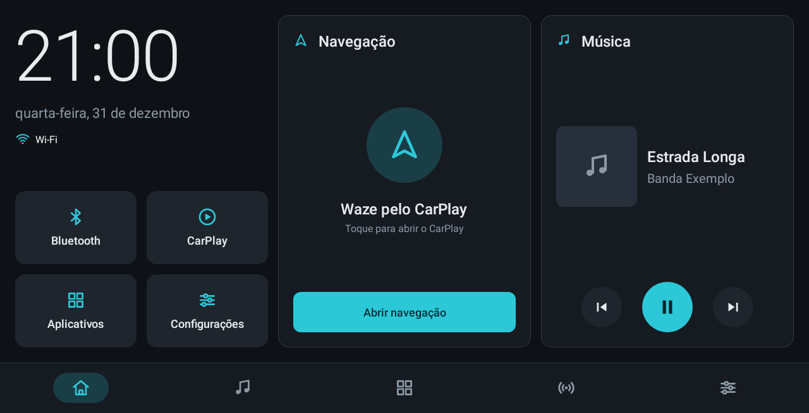
</p>

<p align="center">
  <a href="#o-que-ele-faz">O que ele faz</a> ·
  <a href="#telas">Telas</a> ·
  <a href="#na-central">Na central</a> ·
  <a href="#instalação">Instalação</a> ·
  <a href="#compilar">Compilar</a> ·
  <a href="#limitações-conhecidas">Limitações</a> ·
  <a href="#documentação">Documentação</a>
</p>

O Nyx Car é **leve** e **independente**: não altera o firmware, o ZLINK nem o launcher
original. Está em uso na central como tela inicial. A `1.0.0` é o mesmo código da `0.4.25`,
testada no carro em 15/11/2026.

## O que ele faz

- **Home:** relógio, data, indicadores de Wi-Fi e Bluetooth, cartão de música e atalhos para
  CarPlay, Bluetooth, Aplicativos e Configurações.
- **Barra inferior:** Home, Música, Aplicativos, Conectividade e Configurações; também dá para
  trocar de aba deslizando o dedo.
- **Música:** player próprio das músicas do pendrive, por pastas, com player grande e
  aleatório (da pasta, ou da pasta com as subpastas). Ao ligar o carro, a última música volta
  pausada.
- **Aplicativos:** favoritos editáveis e a lista de todos os apps da central.
- **CarPlay:** telas do Nyx Car cobrem a espera do ZLINK na conexão e no fim. Quando o CarPlay
  termina, pelo cabo ou sem fio, o Nyx Car volta sozinho para a frente.
- **Tela inicial opcional,** com o launcher original a um toque em Configurações.
- **Nyx Diagnóstico:** relatório da central e gravação dos testes no carro, sem
  identificadores nem nomes de músicas.

## Telas

Capturas da versão final, geradas pelos testes de tela na área útil da central
(1280 × 655). As telas do CarPlay ocupam a tela inteira (1280 × 720). Músicas e apps são de
exemplo.

### Abas

<p align="center">
  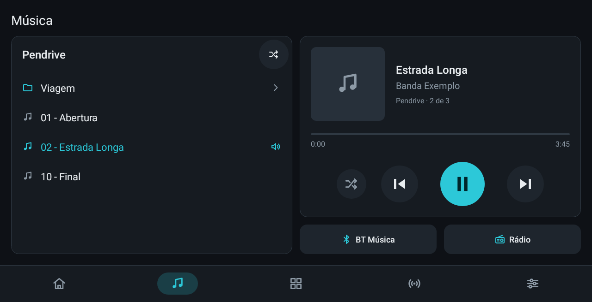
  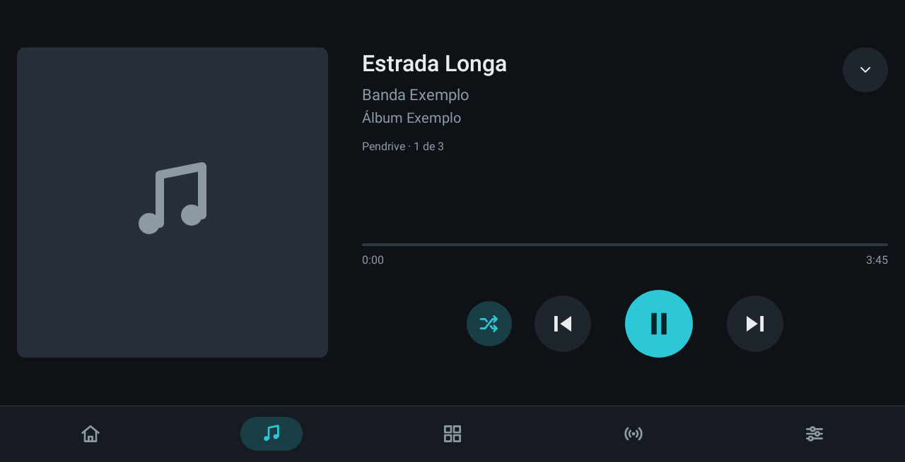
</p>
<p align="center"><sub><b>Música</b>: pastas do pendrive e o player &nbsp;·&nbsp; <b>Player grande</b>, com o aleatório ligado</sub></p>

<p align="center">
  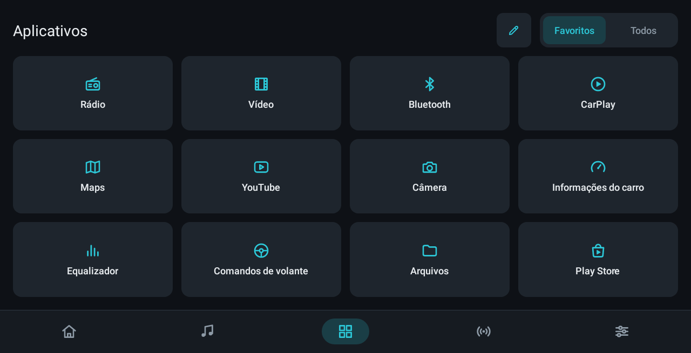
  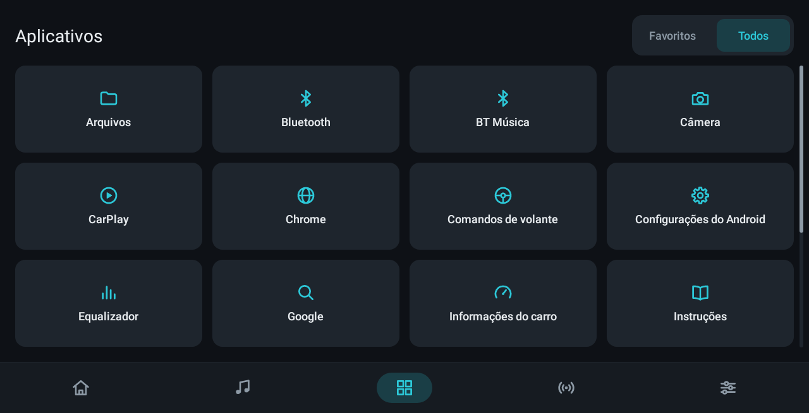
</p>
<p align="center"><sub><b>Aplicativos</b>: favoritos &nbsp;·&nbsp; <b>Aplicativos</b>: todos os apps da central</sub></p>

<p align="center">
  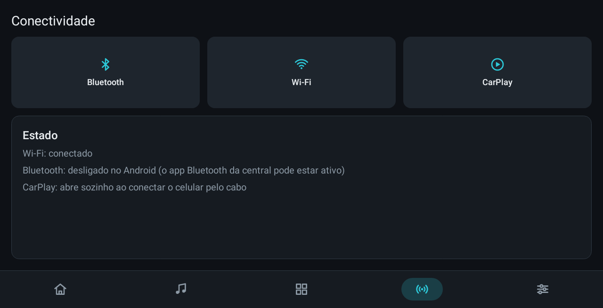
  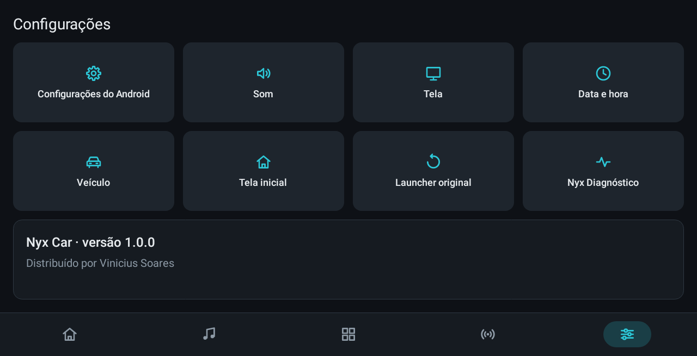
</p>
<p align="center"><sub><b>Conectividade</b> &nbsp;·&nbsp; <b>Configurações</b></sub></p>

### CarPlay

O Nyx Car põe as próprias telas por cima da espera do ZLINK, sem modificá-lo.

<p align="center">
  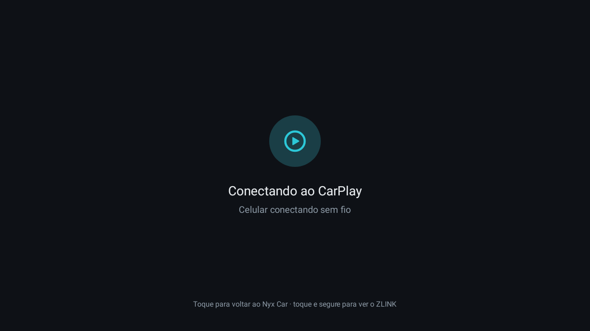
  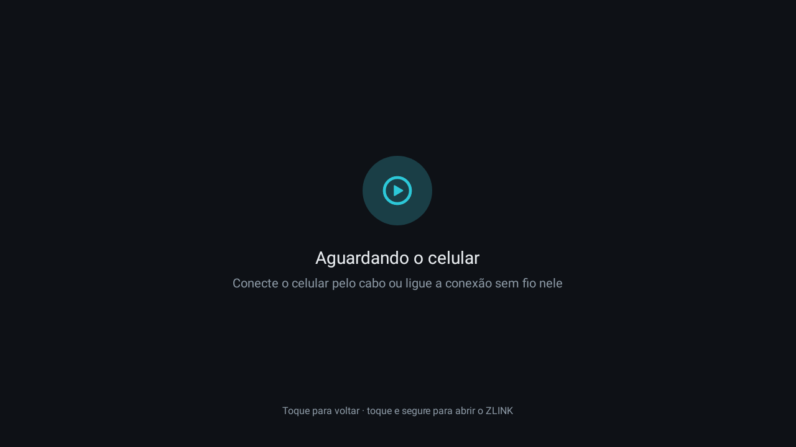
</p>
<p align="center"><sub><b>Conectando</b>, até a imagem do CarPlay chegar &nbsp;·&nbsp; <b>Aguardando o celular</b>, ao tocar em CarPlay sem nada conectado</sub></p>

<p align="center">
  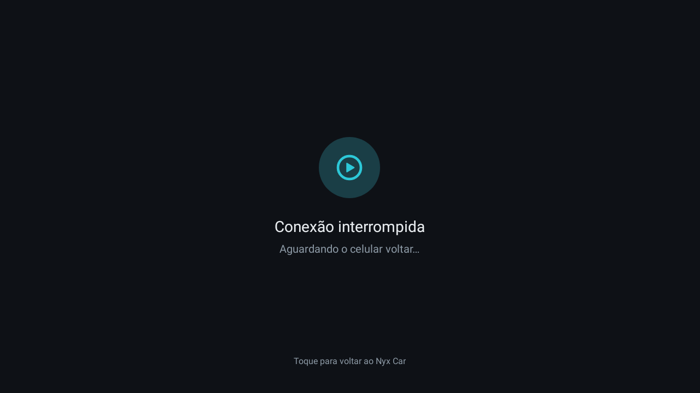
  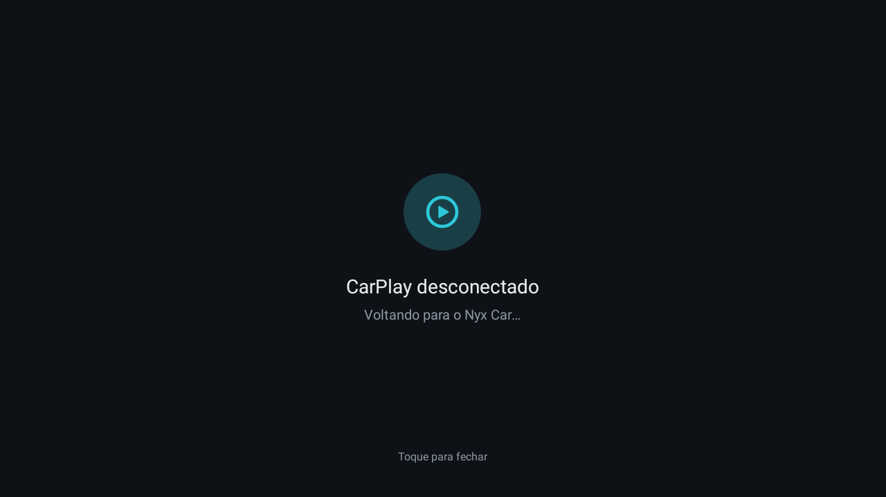
</p>
<p align="center"><sub><b>Conexão interrompida</b>, quando ela cai antes do CarPlay &nbsp;·&nbsp; <b>CarPlay desconectado</b>, no fim, com o Nyx Car voltando</sub></p>

### Design System

Cores, tipografia, medidas e regras no [DESIGN_SYSTEM.md](DESIGN_SYSTEM.md).

<details>
  <summary>Catálogo de componentes: cores, tipografia, botões, atalhos, controles de mídia, ícones e espaçamentos</summary>
  <p align="center">
    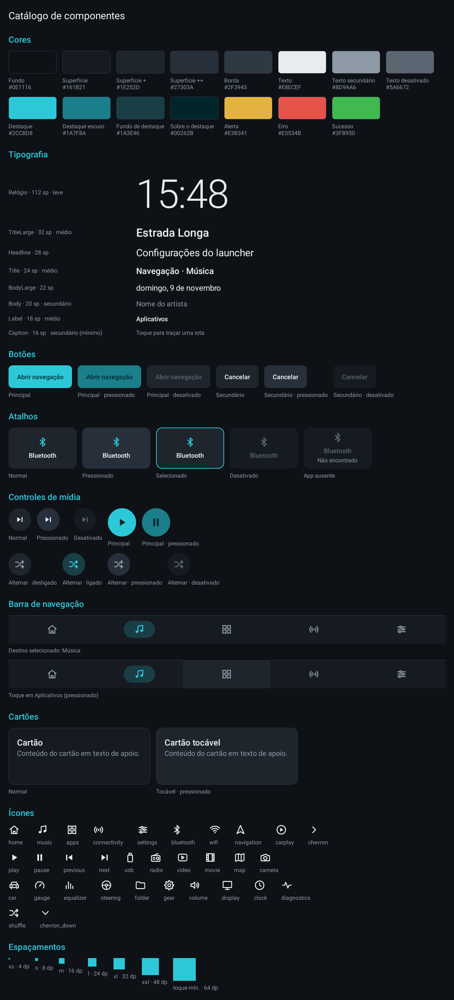
  </p>
</details>

## Na central

- **Sistema:** Android 8.1 real (API 27), rotulado como 13.
- **Processador e gráficos:** AC8227L, com 4× Cortex-A7 a 1,1 GHz (32 bits) e GPU Mali-450.
- **Tela:** 1280 × 720 a 160 dpi, com área útil de 1280 × 655.
- **Interface:** Views nativas, que venceram o Compose no teste A/B.
- **Desempenho:** a Home abre a frio em ~0,7 s, com ~15 MB de memória.

Medições e descobertas no [HARDWARE.md](HARDWARE.md).

## Instalação

A central não tem ADB: a instalação é feita pelo pendrive.

1. Copie o APK gerado ao [compilar](#compilar) (`nyx-car-launcher-release.apk`) para a raiz
   de um pendrive em FAT32.
2. Na central, abra o gerenciador de arquivos, toque no APK e em **Instalar**. Se o Android
   pedir, permita **Instalar apps desconhecidos** para o gerenciador de arquivos.
3. Para usar o Nyx Car como tela inicial, toque em **Configurações → Tela inicial**. O
   launcher original continua a um toque, em **Configurações → Launcher original**.

Desinstalação e recuperação da configuração original no [BUILD.md](BUILD.md).

## Compilar

```bash
git clone https://github.com/viniciussoaresbr/nyx-car-launcher.git
cd nyx-car-launcher
./gradlew assembleRelease     # APK em app/build/outputs/apk/release/
./gradlew testDebugUnitTest   # 244 testes; capturas em app/build/outputs/roborazzi/
```

Requer o JDK 21 e o Android SDK ([BUILD.md](BUILD.md), seção 1).

## Limitações conhecidas

- Sem ADB (bloqueado pelo fabricante): a instalação e os relatórios vão pelo pendrive.
- Sem internet, a central volta à data do firmware quando parte do zero: acerte em
  Configurações → Data e hora.
- Na troca do CarPlay sem fio para o cabo, a tela passa ~12 s pela Home, com "CarPlay
  desconectado", até o iPhone conectar pelo cabo.
- A chave de assinatura fica só no PC de desenvolvimento: um APK compilado em outro PC não
  atualiza o instalado ([ARCHITECTURE.md](ARCHITECTURE.md), D11).

## Documentação

| Documento                            | Conteúdo                                                                           |
| ------------------------------------ | ---------------------------------------------------------------------------------- |
| [PROJECT_PLAN.md](PROJECT_PLAN.md)   | Fases, etapas e critérios de sucesso da primeira versão                            |
| [HARDWARE.md](HARDWARE.md)           | O que se sabe da central: fatos, hipóteses e resultados dos testes                 |
| [ARCHITECTURE.md](ARCHITECTURE.md)   | Decisões técnicas, dependências, riscos e pendências                               |
| [DESIGN_SYSTEM.md](DESIGN_SYSTEM.md) | Cores, tipografia, medidas, componentes e regras visuais                           |
| [BUILD.md](BUILD.md)                 | Ambiente, compilação, testes, instalação via pendrive, desinstalação e recuperação |
| [CHANGELOG.md](CHANGELOG.md)         | Histórico de versões                                                               |

## Restrições do projeto

Sem root, sem desbloqueio de bootloader e sem alterações de firmware, partições ou apps
originais. Única exceção, autorizada pelo usuário: desativar à mão o player original
(reversível; ver PROJECT_PLAN.md, seção 9). O ZLINK nunca é modificado: o Nyx Car só o
abre, o traz para a frente e cobre a tela de espera dele com uma janela própria. Toda
operação na central é explicada e autorizada antes.
